# SyncBench

<p align="center">
  
  
  
  
  
  
  <a href="https://github.com/Indrasai-tech/syncbench/actions/workflows/backend-ci.yml"></a>
  
</p>

<p align="center"><strong>Deterministic offline sync testing, from local edits to conflict reports.</strong></p>

**A deterministic laboratory for testing offline-first synchronization.** SyncBench simulates multiple devices, queued local edits, network faults, retries, duplicate delivery, and server conflict policies. It records a reproducible event timeline and reports lost updates, duplicate business effects, unacknowledged operations, and final-state mismatches.

The API, scenario engine, and iOS client are implemented in **Swift**. The API runs on [Vapor](https://vapor.codes/); the iOS app uses SwiftUI and MVVM. Scenario definitions remain portable JSON data.

> The runner uses a virtual clock. Its retry timings and fault behavior are repeatable simulation results, not real network performance measurements.

## Technology stack

| | Details |
|---|---|
| Layer | Technology | Responsibility |
|---|---|---|
| iOS app | Swift, SwiftUI, MVVM | Dashboard, scenario browser, run history, reports, and server settings |
| HTTP API | Swift, Vapor 4 | Authenticated REST endpoints and background run execution |
| Simulation | Swift, Foundation, Swift Crypto | Virtual clock, deterministic failures, conflict models, assertions, and SHA-256 fingerprints |
| Scenario data | JSON | Portable definitions of initial state, operations, failures, and expected outcomes |
| Run storage | Atomic JSON file | Single-process durable history, configurable with `DATA_DIR` |
| Build and packaging | Swift Package Manager, Docker Compose | Local development and container deployment |
| iOS project generation | XcodeGen | Reproducible Xcode project and scheme |
| CI | GitHub Actions | Swift backend build, scenario tests, and iOS build/test workflow |

## What SyncBench does

1. Loads and validates scenario JSON at startup.
2. Creates an isolated server state and simulated clients for a run.
3. Applies local edits immediately on clients and queues them while offline.
4. Delivers queued operations when a client syncs. A seeded fault injector can delay, lose, reject, or duplicate requests.
5. Resolves conflicts with a declared policy and one of two synchronizer implementations.
6. Evaluates the requested assertions, fingerprints the event log, and saves the report and timeline.
7. Exposes results through the API and the SwiftUI app.

## System architecture

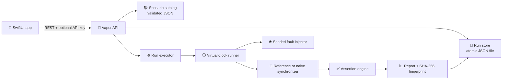

### Run lifecycle

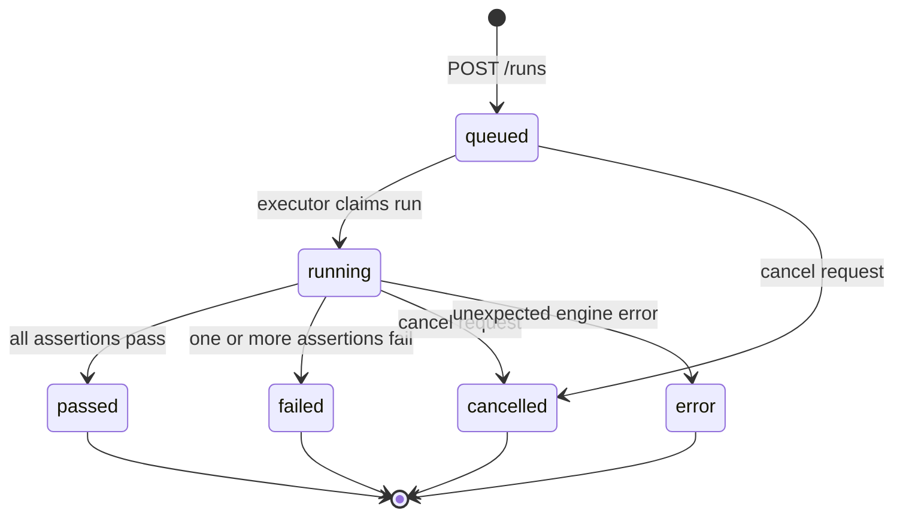

### A sync attempt

```mermaid
sequenceDiagram
    participant D as 📱 Device
    participant N as 🌐 Fault injector
    participant S as 🧠 Synchronizer
    participant E as 📝 Event log
    D->>N: sync(pending operations)
    N->>E: record attempt and injected faults
    alt request timeout or server unavailable
        N-->>D: no successful acknowledgement
        D->>D: schedule exponential backoff
    else request reaches server
        N->>S: deliver operations
        S->>E: record applied, rejected, or duplicate result
        opt response was lost
            N--xD: response lost; client retries
        end
        S-->>D: state snapshot + operation results
        D->>D: acknowledge operations and refresh local state
    end
```

## Synchronization models

| Model | Behavior | Use |
|---|---|---|
| `reference` | Tracks per-field versions and operation IDs. Ignores repeated IDs, applies increments as commutative operations, and resolves stale field writes according to policy. | Baseline for expected safe synchronization behavior. |
| `naive` | Demonstration implementation that overwrites the server record with a client's local snapshot and does not deduplicate delivery. | Negative control: check whether scenarios reveal sync bugs. |

| Conflict policy | Rule for stale edits to the same field |
|---|---|
| `server_wins` | Keep the newer server value; unrelated fields can still merge. |
| `last_write_wins` | Accept the client's stale write when it reaches the server. |
| `merge_non_overlapping_fields` | Keep server edits to fields changed elsewhere while allowing edits to other fields. Same-field stale writes are rejected. |

`increment` is modeled as a commutative operation and adds its numeric value at the server. A regular `update` replaces a field value.

## Quick start

### Requirements

| Requirement | Version / note |
|---|---|
| Swift toolchain | 5.9 or later |
| Xcode | 15 or later for the iOS app |
| Docker | Optional; Docker Compose v2 for the container workflow |
| Network | Swift Package Manager needs access to Vapor and Swift Crypto when resolving the first local build |

### Run the API locally

```bash
cd backend
swift run syncbench-server
```

The API listens on `0.0.0.0:8000`. Scenario files default to `../scenarios` when launched from `backend/`; `DATA_DIR` defaults to `./data`. Set `API_KEY` to protect API routes.

```bash
curl http://127.0.0.1:8000/health
curl http://127.0.0.1:8000/api/v1/scenarios
```

With an API key:

```bash
API_KEY='replace-with-a-long-random-value' swift run syncbench-server
curl -H 'X-API-Key: replace-with-a-long-random-value' http://127.0.0.1:8000/api/v1/scenarios
```

### Run with Docker Compose

```bash
cp .env.example .env
docker compose up --build
```

Run history is saved in the `syncbench-data` volume. Configure `API_KEY` in `.env` before exposing the service to a shared network. To remove run history, remove that Compose volume explicitly.

### Build and launch the iOS app

The XcodeGen project specification is `ios/project.yml`.

```bash
cd ios
xcodegen generate
open SyncBench.xcodeproj
```

Start the API from `backend/` with `swift run syncbench-server`, choose an iOS simulator, and run the **SyncBench** scheme. In **Settings**, enter your Mac's LAN IP with port `8000` (for example, `http://192.168.1.10:8000`) and select **Save & test connection**. The simulator and a physical iPhone must use the Mac's LAN IP; `127.0.0.1` points to the device itself. Find the Mac IP with `ipconfig getifaddr en0`. Use an HTTPS URL for production services.

## Feature guide

| Capability | Details |
|---|---|
| Deterministic simulation | Scenario seed controls jitter; virtual time means simulated delay never sleeps the process. |
| Failure injection | Target a client, sync number, and retry attempt. |
| Retry model | Retry timeout, unavailable server, and lost-response failures with exponential backoff. |
| Idempotency checks | Compare operation IDs in the effect log and flag repeated business effects. |
| Lost-update checks | Compare the last accepted update on each field with final server state. |
| Event timeline | Every simulated action gets an increasing sequence number and virtual timestamp. |
| Reproducibility fingerprint | First 16 hex characters of SHA-256 over the sorted-key encoded event sequence. |
| Human-readable reports | JSON report or Markdown report with assertion details and event references. |
| Run comparison | Execute both synchronizers side-by-side without storing a run. |
| CSV export | Export saved run metadata and fingerprints for spreadsheets. |
| Durable run history | Atomic JSON file writes preserve saved reports across process restarts. |
| API filtering | Filter history by scenario and status; page with limit and offset. |

## Screenshots

Captured from the running SyncBench app in the iPhone simulator and mobile browser. The gallery includes the user's latest dashboard (12 saved runs), the earlier 10-run baseline, scenario browsing and detail, run history, passing and failing reports, settings, and the API health response. The dashboard totals are a point-in-time app history; the reproducible benchmark comparison below always runs the five checked-in scenarios against both synchronizers (10 executions).

<table>
  <tr>
    <td align="center"><a href="docs/screenshots/01-dashboard-12-runs.png">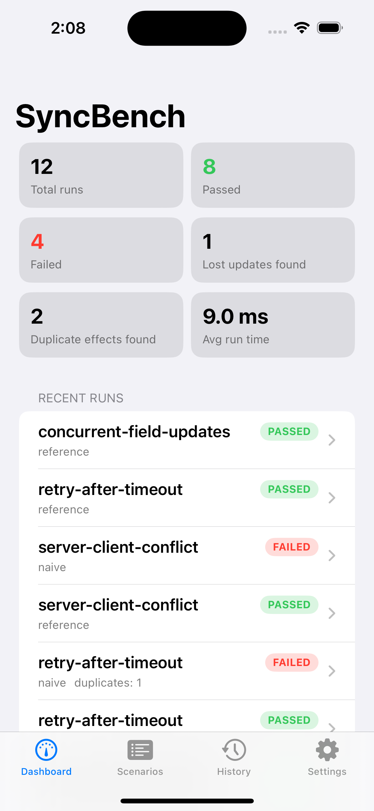</a><br><sub>Latest dashboard · 12 runs · 8 passed · 4 failed</sub></td>
    <td align="center"><a href="docs/screenshots/02-dashboard-10-run-baseline.png">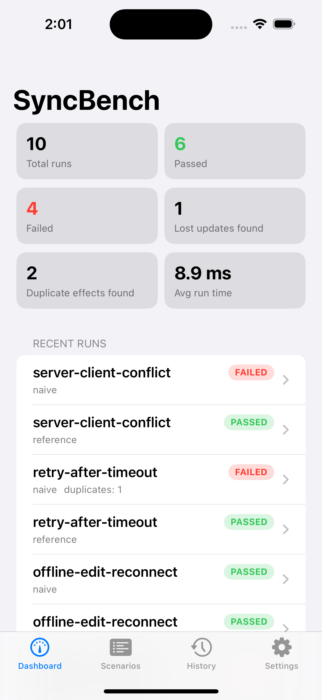</a><br><sub>Initial dashboard · 10-run baseline</sub></td>
    <td align="center"><a href="docs/screenshots/03-scenario-list.png">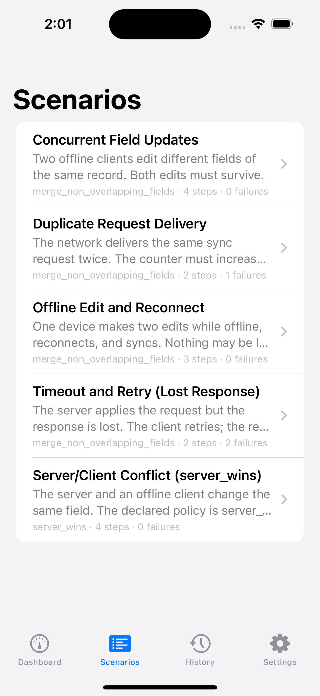</a><br><sub>Scenario library</sub></td>
  </tr>
  <tr>
    <td align="center"><a href="docs/screenshots/04-history.png">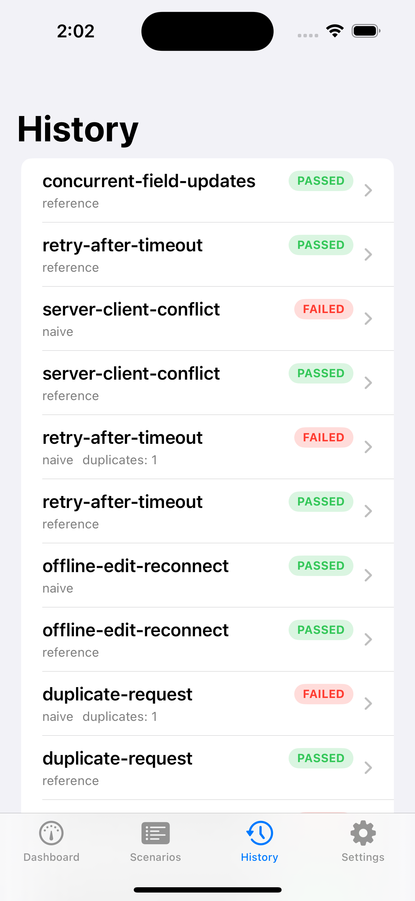</a><br><sub>Saved run history</sub></td>
    <td align="center"><a href="docs/screenshots/05-scenario-timeout-retry.png">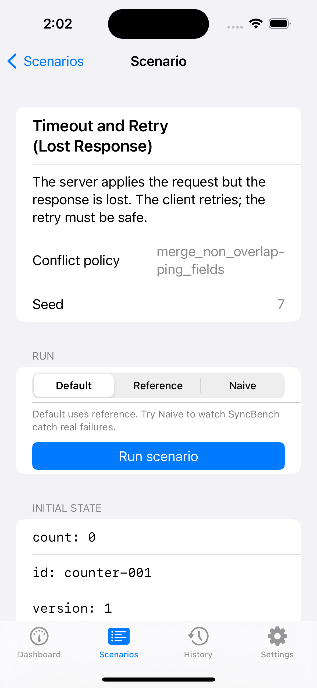</a><br><sub>Timeout and retry scenario</sub></td>
    <td align="center"><a href="docs/screenshots/06-scenario-duplicate-request.png">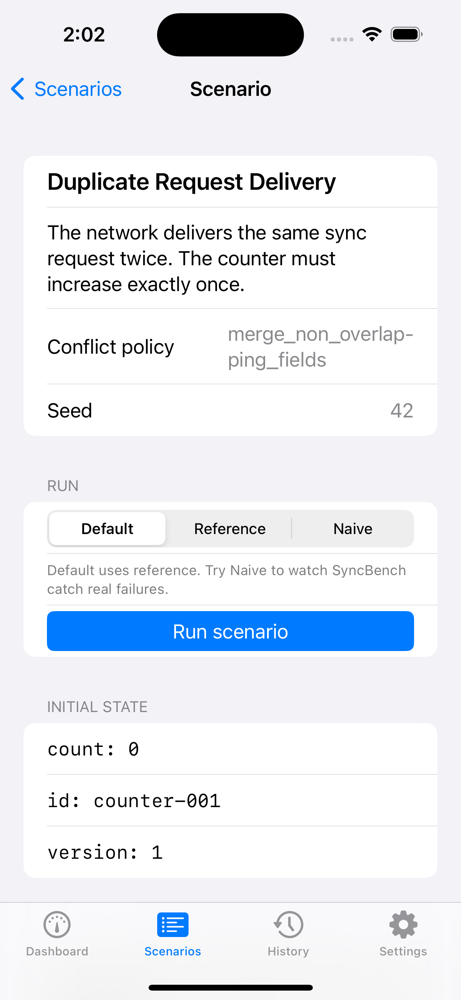</a><br><sub>Duplicate request scenario</sub></td>
  </tr>
  <tr>
    <td align="center"><a href="docs/screenshots/07-scenario-concurrent-updates.png">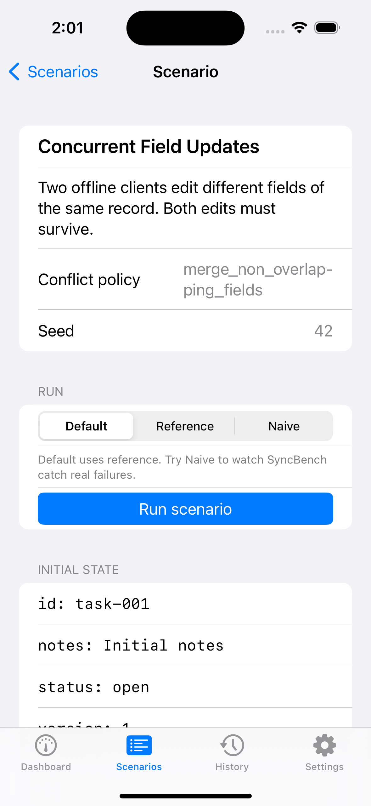</a><br><sub>Concurrent field updates</sub></td>
    <td align="center"><a href="docs/screenshots/08-settings-backend.png">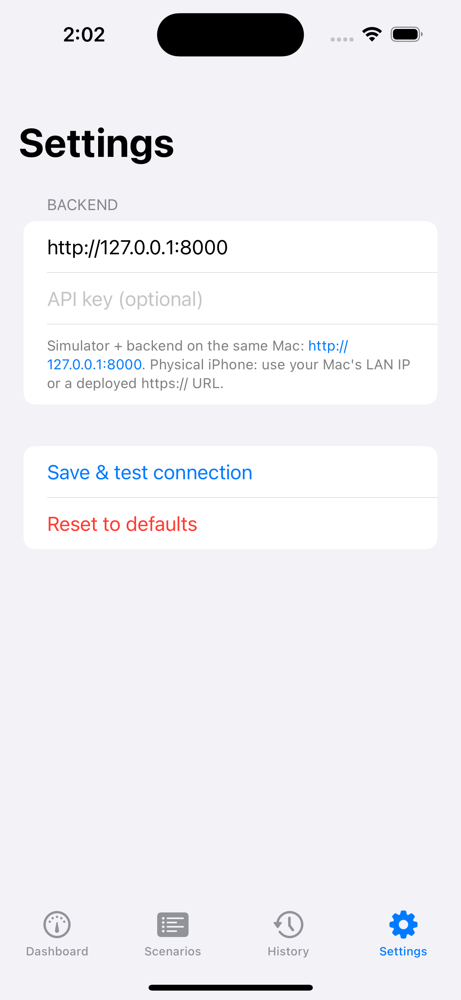</a><br><sub>Backend connection settings</sub></td>
    <td align="center"><a href="docs/screenshots/09-api-health.png">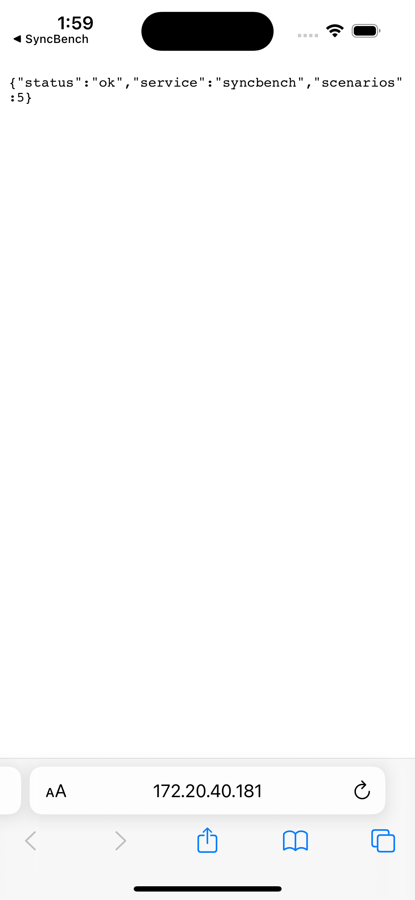</a><br><sub>API health check · HTTP 200</sub></td>
  </tr>
  <tr>
    <td align="center"><a href="docs/screenshots/10-reference-retry-pass.png">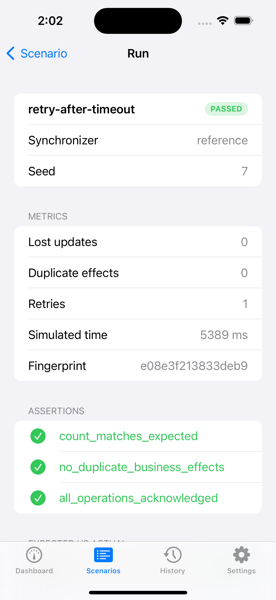</a><br><sub>Reference retry · passed</sub></td>
    <td align="center"><a href="docs/screenshots/11-naive-retry-failure.png">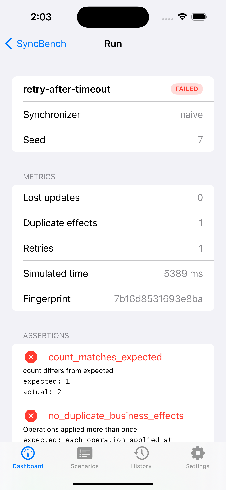</a><br><sub>Naive retry · expected failure</sub></td>
    <td align="center"><a href="docs/screenshots/12-reference-concurrent-pass.png">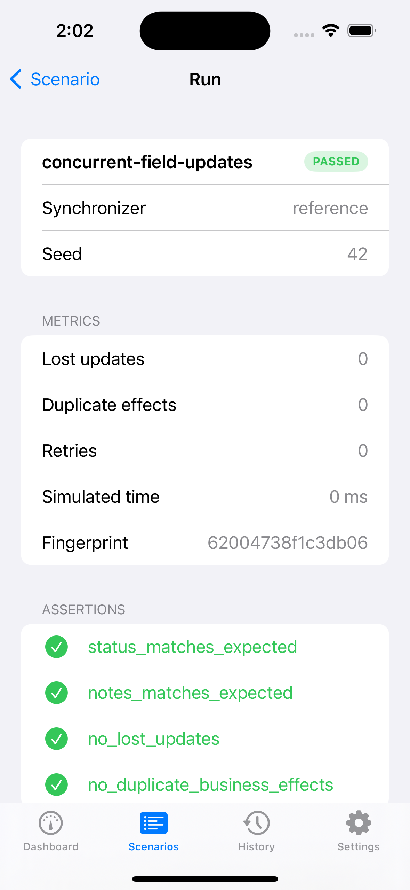</a><br><sub>Reference concurrent update · passed</sub></td>
  </tr>
</table>

The API health screenshot was captured while the service was responding. The settings screenshot shows the simulator loopback URL as configured at that time; for a physical iPhone, enter the Mac's LAN IP as described in [Run the app](#run-the-app). The full run parameters, assertions, final states, event traces, and fingerprints are in [`results/result.md`](results/result.md). The app views are in [`ios/SyncBench/Views`](ios/SyncBench/Views).

## Scenario comparison results

The table below is generated by the Swift simulator. The complete per-run values and trace data are in [`results/result.md`](results/result.md); regenerate the compact comparison table with `cd backend && swift run syncbench-server compare --write ../docs/comparison-results.md`.

| Suite statistic | Measured value |
|---|---:|
| Scenario definitions | 5 |
| Executions (5 scenarios × 2 synchronizers) | 10 |
| Reference runs passed | 5 / 5 |
| Naive runs passed | 1 / 5 |
| Timeline events recorded | 114 |
| Failed assertions across all runs | 7 |
| Lost-update detections | 1 |
| Duplicate-effect detections | 2 |
| Retry attempts | 2 |
| Simulated virtual time | 10,778 ms |

| Scenario | Reference | Naive | Lost updates (naive) | Duplicate effects (naive) | Retries (reference / naive) |
|---|---:|---:|---:|---:|---:|
| Concurrent field updates | ✅ Pass | ❌ Fail | 1 | 0 | 0 / 0 |
| Duplicate request | ✅ Pass | ❌ Fail | 0 | 1 | 0 / 0 |
| Offline edit and reconnect | ✅ Pass | ✅ Pass | 0 | 0 | 0 / 0 |
| Retry after timeout | ✅ Pass | ❌ Fail | 0 | 1 | 1 / 1 |
| Server and client conflict | ✅ Pass | ❌ Fail | 0 | 0 | 0 / 0 |
| **Suite total** | **5/5 passed** | **1/5 passed** | **1** | **2** | **1 / 1** |

These are virtual-clock simulation outcomes, not real network measurements. The `reference` synchronizer serves as the safety baseline; `naive` is the intentional negative control.

### Event record example

Every event includes a monotonic sequence, virtual time, actor, event type, and structured details. A sync trace can look like this:

```json
[
  {"seq": 1, "t_ms": 0, "actor": "runner", "type": "run_started", "detail": {"scenario": "duplicate-request"}},
  {"seq": 2, "t_ms": 0, "actor": "device-A", "type": "local_edit", "detail": {"op_id": "device-A-1", "kind": "increment"}},
  {"seq": 3, "t_ms": 0, "actor": "device-A", "type": "sync_attempt", "detail": {"attempt": 1}},
  {"seq": 4, "t_ms": 0, "actor": "server", "type": "op_applied", "detail": {"op_id": "device-A-1"}},
  {"seq": 5, "t_ms": 0, "actor": "network", "type": "duplicate_delivered", "detail": {"op_ids": ["device-A-1"]}}
]
```

This abbreviated example illustrates the event schema. Use the run's `/events` endpoint for the authoritative, complete trace.

For the complete per-run parameter dump, assertion results, event timelines, fingerprints, and metric definitions, see the generated [detailed result report](results/result.md). Regenerate it from `backend/` with `swift run syncbench-server results --write ../results/result.md`.

## REST API

Base path: `/api/v1`. Send `X-API-Key: <key>` when `API_KEY` is configured. `/health` does not require authentication.

| Method | Endpoint | Purpose | Success response |
|---|---|---|---|
| `GET` | `/health` | Liveness and scenario count | `200` |
| `GET` | `/api/v1/scenarios` | List scenario summaries | `200` |
| `GET` | `/api/v1/scenarios/{scenario_id}` | Return complete scenario definition | `200` |
| `POST` | `/api/v1/scenarios/validate` | Validate a scenario JSON body without running it | `200` or `422` |
| `POST` | `/api/v1/runs` | Queue a scenario run | `202` |
| `POST` | `/api/v1/runs/compare` | Compare reference and naive synchronizers immediately | `200` |
| `GET` | `/api/v1/runs?limit=50&offset=0&scenario_id=...&status=...` | List saved runs, newest first | `200` |
| `GET` | `/api/v1/runs/export.csv` | Download saved run summaries | `200 text/csv` |
| `GET` | `/api/v1/runs/{run_id}` | Read status and run summary | `200` |
| `GET` | `/api/v1/runs/{run_id}/events` | Read event timeline (empty before report is ready) | `200` |
| `GET` | `/api/v1/runs/{run_id}/events?after_seq=0&limit=200` | Read a page of events after a sequence number | `200` |
| `GET` | `/api/v1/runs/{run_id}/report?format=json` | Read complete JSON report | `200` or `409` while running |
| `GET` | `/api/v1/runs/{run_id}/report?format=markdown` | Read formatted Markdown report | `200 text/markdown` or `409` |
| `POST` | `/api/v1/runs/{run_id}/cancel` | Cancel a queued or running run | `200` or `409` if finished |
| `POST` | `/api/v1/runs/{run_id}/replay` | Queue a fresh run with the original scenario, synchronizer, and seed | `202` |
| `GET` | `/api/v1/stats` | Aggregate run and issue metrics | `200` |

### Create a run

```bash
curl -X POST http://127.0.0.1:8000/api/v1/runs \
  -H 'Content-Type: application/json' \
  -d '{"scenario_id":"retry-after-timeout","synchronizer":"reference","seed":7}'
```

Example request fields:

| Field | Type | Required | Meaning |
|---|---|---:|---|
| `scenario_id` | string | Yes | ID of a JSON scenario in `scenarios/`. |
| `synchronizer` | string | No | `reference` or `naive`; defaults to the scenario value. |
| `seed` | integer | No | Override scenario seed for deterministic jitter. |

The returned run ID can be polled at `/api/v1/runs/{run_id}`. Terminal statuses are `passed`, `failed`, `cancelled`, or `error`.

### Replay a saved run

```bash
curl -X POST http://127.0.0.1:8000/api/v1/runs/RUN_ID/replay
```

Replay creates a separate history entry and reuses the original scenario, synchronizer, and seed. Compare the two report fingerprints to check deterministic behavior.

### Page through an event trace

```bash
curl 'http://127.0.0.1:8000/api/v1/runs/RUN_ID/events?after_seq=0&limit=200'
```

Use the last returned `seq` as the next `after_seq`. The maximum page size is 1,000 events.

### Compare without saving

```bash
curl -X POST http://127.0.0.1:8000/api/v1/runs/compare \
  -H 'Content-Type: application/json' \
  -d '{"scenario_id":"duplicate-request","seed":42}'
```

The response includes each complete report, pass/fail booleans, and `first_event_divergence` (the first sequence where event type, actor, or detail differs). `same_fingerprint` compares their full event logs.

### HTTP status and errors

| Code | Meaning |
|---:|---|
| `200` | Successful read/action |
| `202` | Run accepted and queued |
| `401` | Missing or invalid API key when authentication is enabled |
| `404` | Unknown scenario or run ID |
| `409` | Report is not ready, or run is already terminal |
| `422` | Invalid request or unsupported synchronizer |
| `500` | Unexpected server error |

## Scenario format

Each `scenarios/*.json` file is validated before the API starts. Keep scenario files focused: a single scenario should demonstrate one sync property or failure mode.

| Property | Type | Constraints / purpose |
|---|---|---|
| `id` | string | Unique; lowercase letters, digits, hyphens; starts with a letter or digit. |
| `name` | string | Human-readable scenario name. |
| `description` | string | Short explanation shown in the app and API. |
| `policy` | string | `server_wins`, `last_write_wins`, or `merge_non_overlapping_fields`. |
| `synchronizer` | string | Default `reference` or `naive`; defaults to `reference`. |
| `seed` | integer | Default `42`; controls deterministic jitter. |
| `max_retries` | integer | `0`–`10`; default `3`. |
| `timeout_ms` | integer | `1`–`60000`; default `5000`. |
| `initial_state` | object | Starting record. Fields used by operations must exist. |
| `operations` | array | 1–200 ordered client/server actions. |
| `failures` | array | Optional fault rules, default empty. |
| `expected_final_state` | object | Expected values checked at end of run. |
| `assertions` | array | At least one supported assertion name. |

### Operations

| Action | Required fields | Effect |
|---|---|---|
| `update` | `client`, `field`, `value` | Replace a local field and queue an operation. |
| `increment` | `client`, numeric `field`, numeric `value` | Add to the local counter and queue a commutative operation. |
| `sync` | `client` | Send the client's queued operations when online. |
| `go_offline` | `client` | Disable network sync for that simulated client. |
| `go_online` | `client` | Re-enable network sync. |
| `server_update` | `client: "server"`, `field`, `value` | Apply a server-side write before or between client syncs. |

An optional `connection` property (`online` or `offline`) is applied before that operation. This is useful for compact scenario definitions.

### Failure rules

| `type` | Simulation behavior |
|---|---|
| `delay` | Adds `delay_ms` plus deterministic jitter from 0 through `jitter_ms`. |
| `timeout` | Drops the request; the server does not process it; a retry may follow. |
| `server_unavailable` | Simulates a server `503` response without processing the operations. |
| `drop_response` | Server processes the request but the response is lost; retry tests idempotency. |
| `duplicate_delivery` | Delivers the same operation batch a second time. |

| Failure field | Default / constraint |
|---|---|
| `client` | `"*"` for any client. |
| `on_sync` | `1`; positive sync sequence for that client. |
| `on_attempt` | `1`; positive attempt number including retries. |
| `delay_ms` | `0`; from 0 to 60000. |
| `jitter_ms` | `0`; from 0 to 60000. |

### Assertions

| Assertion | Pass condition |
|---|---|
| `no_duplicate_business_effects` | Every operation ID produces at most one accepted business effect. |
| `no_lost_updates` | The server's final value matches the last accepted update for each field. |
| `all_operations_acknowledged` | No simulated client retains pending operations. |
| `final_state_matches_expected` | All expected fields match the final server state. |
| `<field>_matches_expected` | A selected field matches its expected value. |

### Minimal example

```json
{
  "id": "offline-counter",
  "name": "Offline counter increment",
  "description": "A client increments while disconnected, then syncs.",
  "policy": "merge_non_overlapping_fields",
  "synchronizer": "reference",
  "seed": 42,
  "max_retries": 3,
  "timeout_ms": 5000,
  "initial_state": { "count": 0 },
  "operations": [
    { "client": "phone", "connection": "offline", "action": "increment", "field": "count", "value": 1 },
    { "client": "phone", "connection": "online", "action": "sync" }
  ],
  "failures": [],
  "expected_final_state": { "count": 1 },
  "assertions": ["count_matches_expected", "all_operations_acknowledged"]
}
```

## Repository map

| Path | Purpose |
|---|---|
| `backend/Package.swift` | SwiftPM manifest for the Vapor API and Swift Crypto. |
| `backend/Sources/SyncBenchServer/` | Swift API routes, JSON scenario models, runner, assertions, persistence, and CLI. |
| `ios/SyncBench/` | SwiftUI app, models, views, view models, networking, and local settings. |
| `ios/SyncBenchTests/` | iOS model and API-client unit test sources. |
| `ios/project.yml` | XcodeGen project and scheme definition. |
| `scenarios/` | Built-in scenario definitions. |
| `docs/` | Architecture, API, deployment, and platform setup notes. |
| `docker-compose.yml` | Local container service and persistent run-history volume. |
| `backend/Dockerfile` | Multi-stage Swift server build. |

## Common workflows

### Generate a comparison report

```bash
cd backend
swift run syncbench-server compare
swift run syncbench-server compare --write ../docs/comparison-results.md
```

The comparison command executes every scenario with both synchronizers using the same scenario seed. It does not persist run history. Results describe the simulator, not a live network benchmark.

### Add a scenario

1. Add a `.json` file under `scenarios/` using the schema above.
2. Include a short description, expected state, and at least one assertion.
3. Restart the API; startup validation reports malformed or duplicate scenario IDs and prevents serving a partial catalogue.
4. Open the **Scenarios** tab in the iOS app or call `GET /api/v1/scenarios`.
5. Run it against both synchronizers using `POST /api/v1/runs/compare` or save separate runs using `POST /api/v1/runs`.

### Download a report or CSV

```bash
curl 'http://127.0.0.1:8000/api/v1/runs/RUN_ID/report?format=markdown' -o report.md
curl http://127.0.0.1:8000/api/v1/runs/export.csv -o runs.csv
```

Add the `X-API-Key` header to these requests when configured.

### Typical investigation loop

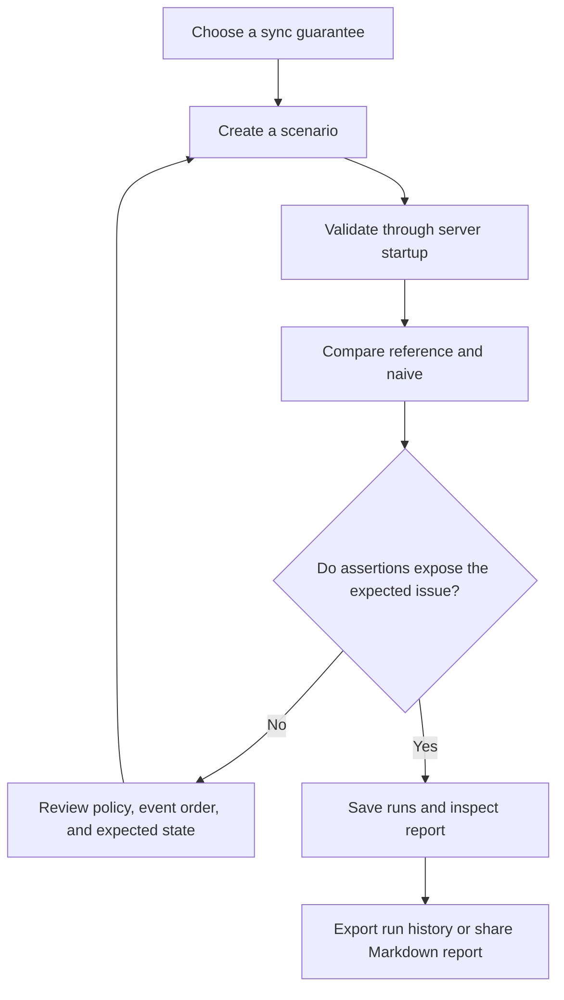

## Configuration

| Variable | Default | Description |
|---|---|---|
| `API_KEY` | empty | When non-empty, protects all `/api/v1` routes using `X-API-Key`. |
| `SCENARIOS_DIR` | `../scenarios` from `backend/` | Directory containing scenario JSON files. |
| `DATA_DIR` | `./data` from current directory | Directory containing atomically written `syncbench-runs.json`. |
| `PORT` | `8000` | HTTP listen port in Docker Compose. |

For local development, set environment variables before `swift run`. For containers, use `.env` with Compose. Do not commit real keys or secrets.

## Persistence and operations

- Run state and completed reports are stored in `DATA_DIR/syncbench-runs.json`.
- Writes replace the file atomically. Mount `DATA_DIR` on durable storage when deploying.
- The bundled Compose workflow mounts a named volume at `/app/data`.
- Scenario JSON is loaded at startup; update scenarios and restart the service to refresh the catalogue.
- Set an API key and use HTTPS in any shared or public environment.
- The built-in run store is intended for a single API process. Use a database-backed store before scaling to multiple replicas or high write volumes.

## Developer notes

The backend package is built with Swift Package Manager. The iOS project remains a separate XcodeGen project. Existing iOS test sources cover model decoding and API URL/header/error behavior.

```bash
cd backend
swift build
swift test
swift run syncbench-server
```

```bash
cd ios
xcodegen generate
# Open SyncBench.xcodeproj and run the SyncBench scheme in Xcode.
```

## Troubleshooting

### App reports that it cannot reach the server

Start the Swift API with `cd backend && swift run syncbench-server`, then set the app's server URL to the Mac's LAN IP and port `8000` in **Settings**. `127.0.0.1` inside the simulator refers to the simulator, not the Mac server. Confirm the address from the simulator browser with `http://<mac-lan-ip>:8000/health`; a working server returns `status: ok` and `scenarios: 5`.

### Xcode times out while searching for the iOS Simulator SDK

Check the selected Xcode and installed Simulator SDK with `xcode-select -p` and `xcrun --sdk iphonesimulator --show-sdk-path`. This project built successfully against Xcode 15.2 and the iOS Simulator 17.2 SDK in the verification environment. If the SDK path exists but Xcode still times out, restart Xcode and Simulator and try the build again.

| Symptom | Check |
|---|---|
| API exits on startup | Confirm `SCENARIOS_DIR` exists and every JSON scenario validates. |
| iOS app cannot connect | Check the server URL, port, LAN reachability, and local-network HTTP settings. |
| API returns `401` | Send the configured `X-API-Key` header. |
| Report returns `409` | The run is queued or running; poll the run endpoint and retry after a terminal status. |
| Run history disappears | Confirm `DATA_DIR` points to persistent storage and that the process can write there. |
| Identical seed gives different jitter | Confirm the scenario, synchronizer, seed, and operation ordering are unchanged. |

## Project documentation

- [Architecture](docs/architecture.md)
- [API specification](docs/api-specification.md)
- [Scenario format](docs/scenario-format.md)
- [Deployment](docs/deployment.md)
- [macOS setup](docs/setup-macos.md)
- [Windows setup](docs/setup-windows.md)
- [Comparison results](docs/comparison-results.md)
