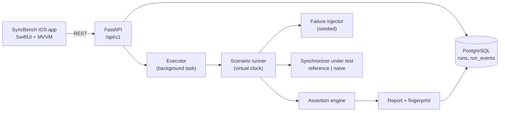

# Architecture

## Run flow
1. `POST /runs` validates the scenario, stores a `queued` run, returns 202.
2. A background task marks it `running` and calls `run_scenario`.
3. The runner walks the scenario operations. Simulated devices queue local edits; `sync` sends pending
   operations through the failure injector to the synchronizer. Every step is logged as an event.
4. The assertion engine compares expected vs actual state, finds lost updates and duplicate effects, and
   links each failed assertion to the relevant event sequence numbers.
5. Report and events are stored; status becomes `passed` / `failed` (or `error`).

## Key design decisions
- **Declared policy defines correctness.** `server_wins`, `last_write_wins`, `merge_non_overlapping_fields`.
- **Determinism.** Failures are addressed by (client, Nth sync, Nth attempt); jitter comes from `random.Random(seed)`;
  time is virtual. A SHA-256 *fingerprint* of the event log proves reproducibility.
- **Lost update** = the last applied update to a field is not the value the server finally holds.
- **Duplicate business effect** = one operation id applied more than once.
- **Pluggable synchronizers.** Implement `receive(client, ops, local_state) -> PushResponse` and register in `make_server`.
