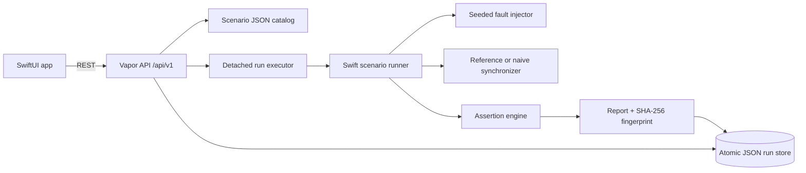

# Architecture

## Run flow

1. `POST /api/v1/runs` validates the requested scenario and synchronizer, saves a `queued` record, and returns `202`.
2. A detached Swift task claims the record as `running` and starts the virtual-clock runner.
3. The runner processes ordered scenario operations. Simulated devices queue local edits; `sync` passes pending edits through the fault injector to the selected synchronizer.
4. Each state change, delivery, retry, and assertion reference is captured as an ordered event.
5. The runner checks expected state, pending operations, lost updates, and duplicate effects, then computes a SHA-256 event fingerprint.
6. The report and timeline are atomically persisted; the run becomes `passed`, `failed`, `cancelled`, or `error`.

## Key design decisions

- **Declared policy defines correctness:** `server_wins`, `last_write_wins`, and `merge_non_overlapping_fields`.
- **Determinism:** failures target a client, sync index, and attempt. Jitter is produced by a seeded generator; time advances virtually.
- **Idempotency:** the reference synchronizer tracks operation IDs and avoids applying duplicate deliveries twice.
- **Lost update:** the final server value differs from the last accepted update to that field.
- **Duplicate effect:** the same operation ID appears more than once in the accepted effect log.
- **Durability:** run records are written atomically to `DATA_DIR/syncbench-runs.json`; the default store supports one API process.
- **Comparison:** the CLI and API can execute both synchronizers against the same scenario and seed.
