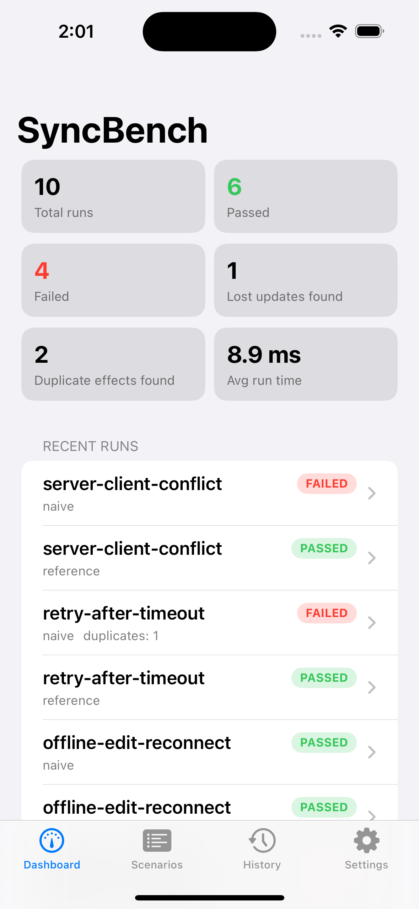
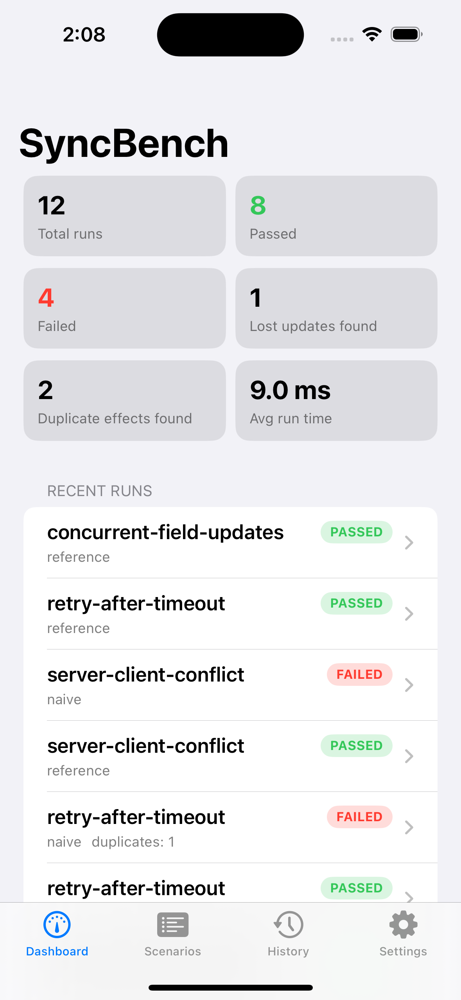

# SyncBench verification results

Generated at 2026-11-01T07:08:47Z.

This report runs every checked-in scenario with both `reference` and `naive`, using the scenario's declared seed. Simulation delays use virtual time; wall-clock milliseconds only measure execution of this process.

## End-to-end app verification

On 2026-11-01, the iOS app was built with Xcode 15.2 for the iPhone 15 Pro Simulator running iOS 17.2, then launched against the local Swift API. The simulator SDK path resolved to `iPhoneSimulator17.2.sdk`; the earlier Xcode SDK-search timeout was transient. During the original verification, the API health, scenario-list, stats, and run-history endpoints returned HTTP 200. The app initially could not reach the API because the simulator was using `127.0.0.1`; setting the simulator app to the Mac's LAN address fixed the connection.

| Live API value | Verified result |
|---|---:|
| Saved runs | 10 |
| Passed | 6 |
| Failed | 4 (expected naive negative-control outcomes) |
| Lost updates detected | 1 |
| Duplicate effects detected | 2 |
| Retries | 2 |
| Average wall time | 8.88 ms |
| Scenario definitions | 5 |

The original simulator dashboard displayed these totals and the recent run history. This earlier real simulator capture is retained as the reproducible 10-run baseline:



### Latest user-captured dashboard

The user subsequently ran two more successful reference scenarios in the app and supplied a fresh dashboard screenshot. Its visible point-in-time totals are:

| Dashboard value | Screenshot value |
|---|---:|
| Saved runs | 12 |
| Passed | 8 |
| Failed | 4 |
| Lost updates found | 1 |
| Duplicate effects found | 2 |
| Average run time | 9.0 ms |



These 12 dashboard entries are saved app history and include the original 10-run baseline plus two later runs. The 10-execution suite summary below remains the deterministic comparison of all five checked-in scenarios against both synchronizers. At report preparation time the local API was stopped, so the newer dashboard totals are transcribed from the user's screenshot and were not refreshed from a live endpoint in this session. The README's [screenshot gallery](../README.md#screenshots) contains 12 curated app and API screenshots; the duplicate screenshot attachment was omitted.

## Metric definitions

| Metric | Meaning |
|---|---|
| Status | `passed` means all requested assertions passed; `failed` means one or more did not. |
| Events | Number of ordered timeline records in the run. |
| Retries | Additional attempts after a failed delivery attempt. |
| Lost updates | Fields whose final server value differs from their last accepted update value. |
| Duplicate effects | Operation IDs accepted more than once by the simulated server. |
| Failed assertions | Requested assertions that did not hold at the end of the run. |
| Simulated ms | Virtual elapsed time from injected delay, timeout, and retry backoff. |
| Wall ms | Process execution time; it varies with machine load and is not simulated network latency. |
| Fingerprint | First 16 hex characters of SHA-256 over the sorted-key encoded event timeline. |

## Suite summary

| Scenario | Mode | Status | Events | Retries | Lost updates | Duplicate effects | Failed assertions | Simulated ms | Wall ms | Fingerprint |
|---|---|---:|---:|---:|---:|---:|---:|---:|---:|---|
| concurrent-field-updates | reference | passed | 14 | 0 | 0 | 0 | 0 | 0 | 44.09 | `62004738f1c3db06` |
| concurrent-field-updates | naive | failed | 14 | 0 | 1 | 0 | 2 | 0 | 4.12 | `47f53cae25797627` |
| duplicate-request | reference | passed | 9 | 0 | 0 | 0 | 0 | 0 | 3.09 | `00b72e2221372882` |
| duplicate-request | naive | failed | 9 | 0 | 0 | 1 | 2 | 0 | 2.30 | `3583fa6993a71bb2` |
| offline-edit-reconnect | reference | passed | 10 | 0 | 0 | 0 | 0 | 0 | 3.75 | `88419aa3827251f5` |
| offline-edit-reconnect | naive | passed | 10 | 0 | 0 | 0 | 0 | 0 | 8.43 | `2596ee1728382b20` |
| retry-after-timeout | reference | passed | 13 | 1 | 0 | 0 | 0 | 5389 | 2.76 | `e08e3f213833deb9` |
| retry-after-timeout | naive | failed | 13 | 1 | 0 | 1 | 2 | 5389 | 2.05 | `7b16d8531693e8ba` |
| server-client-conflict | reference | passed | 11 | 0 | 0 | 0 | 0 | 0 | 2.63 | `42b32af21ba75195` |
| server-client-conflict | naive | failed | 11 | 0 | 0 | 0 | 1 | 0 | 2.00 | `10cc75ce6973fc3c` |

## Detailed scenarios

### Concurrent Field Updates (`concurrent-field-updates`)

Two offline clients edit different fields of the same record. Both edits must survive.

#### Complete scenario parameters

```json
{
  "assertions" : [
    "status_matches_expected",
    "notes_matches_expected",
    "no_lost_updates",
    "no_duplicate_business_effects"
  ],
  "description" : "Two offline clients edit different fields of the same record. Both edits must survive.",
  "expected_final_state" : {
    "notes" : "Checked on site",
    "status" : "completed"
  },
  "failures" : [

  ],
  "id" : "concurrent-field-updates",
  "initial_state" : {
    "id" : "task-001",
    "notes" : "Initial notes",
    "status" : "open",
    "version" : 1
  },
  "max_retries" : 3,
  "name" : "Concurrent Field Updates",
  "operations" : [
    {
      "action" : "update",
      "client" : "device-A",
      "connection" : "offline",
      "field" : "status",
      "value" : "completed"
    },
    {
      "action" : "update",
      "client" : "device-B",
      "connection" : "offline",
      "field" : "notes",
      "value" : "Checked on site"
    },
    {
      "action" : "sync",
      "client" : "device-A",
      "connection" : "online"
    },
    {
      "action" : "sync",
      "client" : "device-B",
      "connection" : "online"
    }
  ],
  "policy" : "merge_non_overlapping_fields",
  "seed" : 42,
  "synchronizer" : "reference",
  "timeout_ms" : 5000
}
```

#### Reference result

| Parameter / metric | Value |
|---|---:|
| Scenario ID | `concurrent-field-updates` |
| Synchronizer | `reference` |
| Policy | `merge_non_overlapping_fields` |
| Seed | 42 |
| Status | **passed** |
| Event count | 14 |
| Retry count | 0 |
| Lost updates | 0 |
| Duplicate effects | 0 |
| Assertions total | 4 |
| Assertions failed | 0 |
| Simulated duration (ms) | 0 |
| Wall time (ms) | 44.09 |
| SHA-256 event fingerprint (first 16 hex) | `62004738f1c3db06` |

Final server state:

```json
{
  "id" : "task-001",
  "notes" : "Checked on site",
  "status" : "completed",
  "version" : 1
}
```

Assertions:

| Assertion | Passed | Expected | Actual | Message | Event sequences |
|---|---:|---|---|---|---|
| `status_matches_expected` | yes | `"completed"` | `"completed"` | OK |  |
| `notes_matches_expected` | yes | `"Checked on site"` | `"Checked on site"` | OK |  |
| `no_lost_updates` | yes | `"final value equals last applied update"` | `0` | OK |  |
| `no_duplicate_business_effects` | yes | `"each operation applied at most once"` | `"no duplicates"` | OK |  |

Event timeline:

| Seq | Virtual ms | Actor | Event | Detail |
|---:|---:|---|---|---|
| 1 | 0 | runner | `run_started` | `{
  "policy" : "merge_non_overlapping_fields",
  "scenario" : "concurrent-field-updates",
  "seed" : 42,
  "synchronizer" : "reference"
}` |
| 2 | 0 | device-A | `connection_offline` | `{

}` |
| 3 | 0 | device-A | `local_edit` | `{
  "field" : "status",
  "kind" : "update",
  "offline" : true,
  "op_id" : "device-A-1",
  "queued" : 1,
  "value" : "completed"
}` |
| 4 | 0 | device-B | `connection_offline` | `{

}` |
| 5 | 0 | device-B | `local_edit` | `{
  "field" : "notes",
  "kind" : "update",
  "offline" : true,
  "op_id" : "device-B-1",
  "queued" : 1,
  "value" : "Checked on site"
}` |
| 6 | 0 | device-A | `connection_online` | `{

}` |
| 7 | 0 | device-A | `sync_attempt` | `{
  "attempt" : 1,
  "injected" : [

  ],
  "op_ids" : [
    "device-A-1"
  ]
}` |
| 8 | 0 | server | `op_applied` | `{
  "field" : "status",
  "op_id" : "device-A-1"
}` |
| 9 | 0 | device-A | `sync_complete` | `{
  "attempt" : 1,
  "pending" : 0
}` |
| 10 | 0 | device-B | `connection_online` | `{

}` |
| 11 | 0 | device-B | `sync_attempt` | `{
  "attempt" : 1,
  "injected" : [

  ],
  "op_ids" : [
    "device-B-1"
  ]
}` |
| 12 | 0 | server | `op_applied` | `{
  "field" : "notes",
  "op_id" : "device-B-1"
}` |
| 13 | 0 | device-B | `sync_complete` | `{
  "attempt" : 1,
  "pending" : 0
}` |
| 14 | 0 | runner | `run_finished` | `{
  "passed" : true
}` |

#### Naive result

| Parameter / metric | Value |
|---|---:|
| Scenario ID | `concurrent-field-updates` |
| Synchronizer | `naive` |
| Policy | `merge_non_overlapping_fields` |
| Seed | 42 |
| Status | **failed** |
| Event count | 14 |
| Retry count | 0 |
| Lost updates | 1 |
| Duplicate effects | 0 |
| Assertions total | 4 |
| Assertions failed | 2 |
| Simulated duration (ms) | 0 |
| Wall time (ms) | 4.12 |
| SHA-256 event fingerprint (first 16 hex) | `47f53cae25797627` |

Final server state:

```json
{
  "id" : "task-001",
  "notes" : "Checked on site",
  "status" : "open",
  "version" : 1
}
```

Assertions:

| Assertion | Passed | Expected | Actual | Message | Event sequences |
|---|---:|---|---|---|---|
| `status_matches_expected` | no | `"completed"` | `"open"` | status differs from expected | 3, 8 |
| `notes_matches_expected` | yes | `"Checked on site"` | `"Checked on site"` | OK |  |
| `no_lost_updates` | no | `"final value equals last applied update"` | `1` | Updates were overwritten after being applied | 8, 3 |
| `no_duplicate_business_effects` | yes | `"each operation applied at most once"` | `"no duplicates"` | OK |  |

Event timeline:

| Seq | Virtual ms | Actor | Event | Detail |
|---:|---:|---|---|---|
| 1 | 0 | runner | `run_started` | `{
  "policy" : "merge_non_overlapping_fields",
  "scenario" : "concurrent-field-updates",
  "seed" : 42,
  "synchronizer" : "naive"
}` |
| 2 | 0 | device-A | `connection_offline` | `{

}` |
| 3 | 0 | device-A | `local_edit` | `{
  "field" : "status",
  "kind" : "update",
  "offline" : true,
  "op_id" : "device-A-1",
  "queued" : 1,
  "value" : "completed"
}` |
| 4 | 0 | device-B | `connection_offline` | `{

}` |
| 5 | 0 | device-B | `local_edit` | `{
  "field" : "notes",
  "kind" : "update",
  "offline" : true,
  "op_id" : "device-B-1",
  "queued" : 1,
  "value" : "Checked on site"
}` |
| 6 | 0 | device-A | `connection_online` | `{

}` |
| 7 | 0 | device-A | `sync_attempt` | `{
  "attempt" : 1,
  "injected" : [

  ],
  "op_ids" : [
    "device-A-1"
  ]
}` |
| 8 | 0 | server | `op_applied` | `{
  "field" : "status",
  "op_id" : "device-A-1"
}` |
| 9 | 0 | device-A | `sync_complete` | `{
  "attempt" : 1,
  "pending" : 0
}` |
| 10 | 0 | device-B | `connection_online` | `{

}` |
| 11 | 0 | device-B | `sync_attempt` | `{
  "attempt" : 1,
  "injected" : [

  ],
  "op_ids" : [
    "device-B-1"
  ]
}` |
| 12 | 0 | server | `op_applied` | `{
  "field" : "notes",
  "op_id" : "device-B-1"
}` |
| 13 | 0 | device-B | `sync_complete` | `{
  "attempt" : 1,
  "pending" : 0
}` |
| 14 | 0 | runner | `run_finished` | `{
  "passed" : false
}` |

### Duplicate Request Delivery (`duplicate-request`)

The network delivers the same sync request twice. The counter must increase exactly once.

#### Complete scenario parameters

```json
{
  "assertions" : [
    "count_matches_expected",
    "no_duplicate_business_effects",
    "all_operations_acknowledged"
  ],
  "description" : "The network delivers the same sync request twice. The counter must increase exactly once.",
  "expected_final_state" : {
    "count" : 1
  },
  "failures" : [
    {
      "client" : "device-A",
      "delay_ms" : 0,
      "jitter_ms" : 0,
      "on_attempt" : 1,
      "on_sync" : 1,
      "type" : "duplicate_delivery"
    }
  ],
  "id" : "duplicate-request",
  "initial_state" : {
    "count" : 0,
    "id" : "counter-001",
    "version" : 1
  },
  "max_retries" : 3,
  "name" : "Duplicate Request Delivery",
  "operations" : [
    {
      "action" : "increment",
      "client" : "device-A",
      "connection" : "offline",
      "field" : "count",
      "value" : 1
    },
    {
      "action" : "sync",
      "client" : "device-A",
      "connection" : "online"
    }
  ],
  "policy" : "merge_non_overlapping_fields",
  "seed" : 42,
  "synchronizer" : "reference",
  "timeout_ms" : 5000
}
```

#### Reference result

| Parameter / metric | Value |
|---|---:|
| Scenario ID | `duplicate-request` |
| Synchronizer | `reference` |
| Policy | `merge_non_overlapping_fields` |
| Seed | 42 |
| Status | **passed** |
| Event count | 9 |
| Retry count | 0 |
| Lost updates | 0 |
| Duplicate effects | 0 |
| Assertions total | 3 |
| Assertions failed | 0 |
| Simulated duration (ms) | 0 |
| Wall time (ms) | 3.09 |
| SHA-256 event fingerprint (first 16 hex) | `00b72e2221372882` |

Final server state:

```json
{
  "count" : 1,
  "id" : "counter-001",
  "version" : 1
}
```

Assertions:

| Assertion | Passed | Expected | Actual | Message | Event sequences |
|---|---:|---|---|---|---|
| `count_matches_expected` | yes | `1` | `1` | OK |  |
| `no_duplicate_business_effects` | yes | `"each operation applied at most once"` | `"no duplicates"` | OK |  |
| `all_operations_acknowledged` | yes | `"no pending operations"` | `0` | OK |  |

Event timeline:

| Seq | Virtual ms | Actor | Event | Detail |
|---:|---:|---|---|---|
| 1 | 0 | runner | `run_started` | `{
  "policy" : "merge_non_overlapping_fields",
  "scenario" : "duplicate-request",
  "seed" : 42,
  "synchronizer" : "reference"
}` |
| 2 | 0 | device-A | `connection_offline` | `{

}` |
| 3 | 0 | device-A | `local_edit` | `{
  "field" : "count",
  "kind" : "increment",
  "offline" : true,
  "op_id" : "device-A-1",
  "queued" : 1,
  "value" : 1
}` |
| 4 | 0 | device-A | `connection_online` | `{

}` |
| 5 | 0 | device-A | `sync_attempt` | `{
  "attempt" : 1,
  "injected" : [
    "duplicate_delivery"
  ],
  "op_ids" : [
    "device-A-1"
  ]
}` |
| 6 | 0 | server | `op_applied` | `{
  "field" : "count",
  "op_id" : "device-A-1"
}` |
| 7 | 0 | network | `duplicate_delivered` | `{
  "op_ids" : [
    "device-A-1"
  ]
}` |
| 8 | 0 | device-A | `sync_complete` | `{
  "attempt" : 1,
  "pending" : 0
}` |
| 9 | 0 | runner | `run_finished` | `{
  "passed" : true
}` |

#### Naive result

| Parameter / metric | Value |
|---|---:|
| Scenario ID | `duplicate-request` |
| Synchronizer | `naive` |
| Policy | `merge_non_overlapping_fields` |
| Seed | 42 |
| Status | **failed** |
| Event count | 9 |
| Retry count | 0 |
| Lost updates | 0 |
| Duplicate effects | 1 |
| Assertions total | 3 |
| Assertions failed | 2 |
| Simulated duration (ms) | 0 |
| Wall time (ms) | 2.30 |
| SHA-256 event fingerprint (first 16 hex) | `3583fa6993a71bb2` |

Final server state:

```json
{
  "count" : 2,
  "id" : "counter-001",
  "version" : 1
}
```

Assertions:

| Assertion | Passed | Expected | Actual | Message | Event sequences |
|---|---:|---|---|---|---|
| `count_matches_expected` | no | `1` | `2` | count differs from expected | 3, 6 |
| `no_duplicate_business_effects` | no | `"each operation applied at most once"` | `{
  "device-A-1" : 2
}` | Operations applied more than once | 3, 6 |
| `all_operations_acknowledged` | yes | `"no pending operations"` | `0` | OK |  |

Event timeline:

| Seq | Virtual ms | Actor | Event | Detail |
|---:|---:|---|---|---|
| 1 | 0 | runner | `run_started` | `{
  "policy" : "merge_non_overlapping_fields",
  "scenario" : "duplicate-request",
  "seed" : 42,
  "synchronizer" : "naive"
}` |
| 2 | 0 | device-A | `connection_offline` | `{

}` |
| 3 | 0 | device-A | `local_edit` | `{
  "field" : "count",
  "kind" : "increment",
  "offline" : true,
  "op_id" : "device-A-1",
  "queued" : 1,
  "value" : 1
}` |
| 4 | 0 | device-A | `connection_online` | `{

}` |
| 5 | 0 | device-A | `sync_attempt` | `{
  "attempt" : 1,
  "injected" : [
    "duplicate_delivery"
  ],
  "op_ids" : [
    "device-A-1"
  ]
}` |
| 6 | 0 | server | `op_applied` | `{
  "field" : "count",
  "op_id" : "device-A-1"
}` |
| 7 | 0 | network | `duplicate_delivered` | `{
  "op_ids" : [
    "device-A-1"
  ]
}` |
| 8 | 0 | device-A | `sync_complete` | `{
  "attempt" : 1,
  "pending" : 0
}` |
| 9 | 0 | runner | `run_finished` | `{
  "passed" : false
}` |

### Offline Edit and Reconnect (`offline-edit-reconnect`)

One device makes two edits while offline, reconnects, and syncs. Nothing may be lost.

#### Complete scenario parameters

```json
{
  "assertions" : [
    "status_matches_expected",
    "notes_matches_expected",
    "no_lost_updates",
    "all_operations_acknowledged"
  ],
  "description" : "One device makes two edits while offline, reconnects, and syncs. Nothing may be lost.",
  "expected_final_state" : {
    "notes" : "Checked on site",
    "status" : "completed"
  },
  "failures" : [

  ],
  "id" : "offline-edit-reconnect",
  "initial_state" : {
    "id" : "task-001",
    "notes" : "Initial notes",
    "status" : "open",
    "version" : 1
  },
  "max_retries" : 3,
  "name" : "Offline Edit and Reconnect",
  "operations" : [
    {
      "action" : "update",
      "client" : "device-A",
      "connection" : "offline",
      "field" : "status",
      "value" : "completed"
    },
    {
      "action" : "update",
      "client" : "device-A",
      "connection" : "offline",
      "field" : "notes",
      "value" : "Checked on site"
    },
    {
      "action" : "sync",
      "client" : "device-A",
      "connection" : "online"
    }
  ],
  "policy" : "merge_non_overlapping_fields",
  "seed" : 42,
  "synchronizer" : "reference",
  "timeout_ms" : 5000
}
```

#### Reference result

| Parameter / metric | Value |
|---|---:|
| Scenario ID | `offline-edit-reconnect` |
| Synchronizer | `reference` |
| Policy | `merge_non_overlapping_fields` |
| Seed | 42 |
| Status | **passed** |
| Event count | 10 |
| Retry count | 0 |
| Lost updates | 0 |
| Duplicate effects | 0 |
| Assertions total | 4 |
| Assertions failed | 0 |
| Simulated duration (ms) | 0 |
| Wall time (ms) | 3.75 |
| SHA-256 event fingerprint (first 16 hex) | `88419aa3827251f5` |

Final server state:

```json
{
  "id" : "task-001",
  "notes" : "Checked on site",
  "status" : "completed",
  "version" : 1
}
```

Assertions:

| Assertion | Passed | Expected | Actual | Message | Event sequences |
|---|---:|---|---|---|---|
| `status_matches_expected` | yes | `"completed"` | `"completed"` | OK |  |
| `notes_matches_expected` | yes | `"Checked on site"` | `"Checked on site"` | OK |  |
| `no_lost_updates` | yes | `"final value equals last applied update"` | `0` | OK |  |
| `all_operations_acknowledged` | yes | `"no pending operations"` | `0` | OK |  |

Event timeline:

| Seq | Virtual ms | Actor | Event | Detail |
|---:|---:|---|---|---|
| 1 | 0 | runner | `run_started` | `{
  "policy" : "merge_non_overlapping_fields",
  "scenario" : "offline-edit-reconnect",
  "seed" : 42,
  "synchronizer" : "reference"
}` |
| 2 | 0 | device-A | `connection_offline` | `{

}` |
| 3 | 0 | device-A | `local_edit` | `{
  "field" : "status",
  "kind" : "update",
  "offline" : true,
  "op_id" : "device-A-1",
  "queued" : 1,
  "value" : "completed"
}` |
| 4 | 0 | device-A | `local_edit` | `{
  "field" : "notes",
  "kind" : "update",
  "offline" : true,
  "op_id" : "device-A-2",
  "queued" : 2,
  "value" : "Checked on site"
}` |
| 5 | 0 | device-A | `connection_online` | `{

}` |
| 6 | 0 | device-A | `sync_attempt` | `{
  "attempt" : 1,
  "injected" : [

  ],
  "op_ids" : [
    "device-A-1",
    "device-A-2"
  ]
}` |
| 7 | 0 | server | `op_applied` | `{
  "field" : "status",
  "op_id" : "device-A-1"
}` |
| 8 | 0 | server | `op_applied` | `{
  "field" : "notes",
  "op_id" : "device-A-2"
}` |
| 9 | 0 | device-A | `sync_complete` | `{
  "attempt" : 1,
  "pending" : 0
}` |
| 10 | 0 | runner | `run_finished` | `{
  "passed" : true
}` |

#### Naive result

| Parameter / metric | Value |
|---|---:|
| Scenario ID | `offline-edit-reconnect` |
| Synchronizer | `naive` |
| Policy | `merge_non_overlapping_fields` |
| Seed | 42 |
| Status | **passed** |
| Event count | 10 |
| Retry count | 0 |
| Lost updates | 0 |
| Duplicate effects | 0 |
| Assertions total | 4 |
| Assertions failed | 0 |
| Simulated duration (ms) | 0 |
| Wall time (ms) | 8.43 |
| SHA-256 event fingerprint (first 16 hex) | `2596ee1728382b20` |

Final server state:

```json
{
  "id" : "task-001",
  "notes" : "Checked on site",
  "status" : "completed",
  "version" : 1
}
```

Assertions:

| Assertion | Passed | Expected | Actual | Message | Event sequences |
|---|---:|---|---|---|---|
| `status_matches_expected` | yes | `"completed"` | `"completed"` | OK |  |
| `notes_matches_expected` | yes | `"Checked on site"` | `"Checked on site"` | OK |  |
| `no_lost_updates` | yes | `"final value equals last applied update"` | `0` | OK |  |
| `all_operations_acknowledged` | yes | `"no pending operations"` | `0` | OK |  |

Event timeline:

| Seq | Virtual ms | Actor | Event | Detail |
|---:|---:|---|---|---|
| 1 | 0 | runner | `run_started` | `{
  "policy" : "merge_non_overlapping_fields",
  "scenario" : "offline-edit-reconnect",
  "seed" : 42,
  "synchronizer" : "naive"
}` |
| 2 | 0 | device-A | `connection_offline` | `{

}` |
| 3 | 0 | device-A | `local_edit` | `{
  "field" : "status",
  "kind" : "update",
  "offline" : true,
  "op_id" : "device-A-1",
  "queued" : 1,
  "value" : "completed"
}` |
| 4 | 0 | device-A | `local_edit` | `{
  "field" : "notes",
  "kind" : "update",
  "offline" : true,
  "op_id" : "device-A-2",
  "queued" : 2,
  "value" : "Checked on site"
}` |
| 5 | 0 | device-A | `connection_online` | `{

}` |
| 6 | 0 | device-A | `sync_attempt` | `{
  "attempt" : 1,
  "injected" : [

  ],
  "op_ids" : [
    "device-A-1",
    "device-A-2"
  ]
}` |
| 7 | 0 | server | `op_applied` | `{
  "field" : "status",
  "op_id" : "device-A-1"
}` |
| 8 | 0 | server | `op_applied` | `{
  "field" : "notes",
  "op_id" : "device-A-2"
}` |
| 9 | 0 | device-A | `sync_complete` | `{
  "attempt" : 1,
  "pending" : 0
}` |
| 10 | 0 | runner | `run_finished` | `{
  "passed" : true
}` |

### Timeout and Retry (Lost Response) (`retry-after-timeout`)

The server applies the request but the response is lost. The client retries; the retry must be safe.

#### Complete scenario parameters

```json
{
  "assertions" : [
    "count_matches_expected",
    "no_duplicate_business_effects",
    "all_operations_acknowledged"
  ],
  "description" : "The server applies the request but the response is lost. The client retries; the retry must be safe.",
  "expected_final_state" : {
    "count" : 1
  },
  "failures" : [
    {
      "client" : "device-A",
      "delay_ms" : 200,
      "jitter_ms" : 100,
      "on_attempt" : 1,
      "on_sync" : 1,
      "type" : "delay"
    },
    {
      "client" : "device-A",
      "delay_ms" : 0,
      "jitter_ms" : 0,
      "on_attempt" : 1,
      "on_sync" : 1,
      "type" : "drop_response"
    }
  ],
  "id" : "retry-after-timeout",
  "initial_state" : {
    "count" : 0,
    "id" : "counter-001",
    "version" : 1
  },
  "max_retries" : 3,
  "name" : "Timeout and Retry (Lost Response)",
  "operations" : [
    {
      "action" : "increment",
      "client" : "device-A",
      "connection" : "offline",
      "field" : "count",
      "value" : 1
    },
    {
      "action" : "sync",
      "client" : "device-A",
      "connection" : "online"
    }
  ],
  "policy" : "merge_non_overlapping_fields",
  "seed" : 7,
  "synchronizer" : "reference",
  "timeout_ms" : 5000
}
```

#### Reference result

| Parameter / metric | Value |
|---|---:|
| Scenario ID | `retry-after-timeout` |
| Synchronizer | `reference` |
| Policy | `merge_non_overlapping_fields` |
| Seed | 7 |
| Status | **passed** |
| Event count | 13 |
| Retry count | 1 |
| Lost updates | 0 |
| Duplicate effects | 0 |
| Assertions total | 3 |
| Assertions failed | 0 |
| Simulated duration (ms) | 5389 |
| Wall time (ms) | 2.76 |
| SHA-256 event fingerprint (first 16 hex) | `e08e3f213833deb9` |

Final server state:

```json
{
  "count" : 1,
  "id" : "counter-001",
  "version" : 1
}
```

Assertions:

| Assertion | Passed | Expected | Actual | Message | Event sequences |
|---|---:|---|---|---|---|
| `count_matches_expected` | yes | `1` | `1` | OK |  |
| `no_duplicate_business_effects` | yes | `"each operation applied at most once"` | `"no duplicates"` | OK |  |
| `all_operations_acknowledged` | yes | `"no pending operations"` | `0` | OK |  |

Event timeline:

| Seq | Virtual ms | Actor | Event | Detail |
|---:|---:|---|---|---|
| 1 | 0 | runner | `run_started` | `{
  "policy" : "merge_non_overlapping_fields",
  "scenario" : "retry-after-timeout",
  "seed" : 7,
  "synchronizer" : "reference"
}` |
| 2 | 0 | device-A | `connection_offline` | `{

}` |
| 3 | 0 | device-A | `local_edit` | `{
  "field" : "count",
  "kind" : "increment",
  "offline" : true,
  "op_id" : "device-A-1",
  "queued" : 1,
  "value" : 1
}` |
| 4 | 0 | device-A | `connection_online` | `{

}` |
| 5 | 0 | device-A | `sync_attempt` | `{
  "attempt" : 1,
  "injected" : [
    "delay",
    "drop_response"
  ],
  "op_ids" : [
    "device-A-1"
  ]
}` |
| 6 | 289 | network | `delay` | `{
  "ms" : 289
}` |
| 7 | 289 | server | `op_applied` | `{
  "field" : "count",
  "op_id" : "device-A-1"
}` |
| 8 | 5289 | network | `response_lost` | `{
  "reason" : "timeout"
}` |
| 9 | 5389 | device-A | `retry_scheduled` | `{
  "backoff_ms" : 100,
  "next_attempt" : 2
}` |
| 10 | 5389 | device-A | `sync_attempt` | `{
  "attempt" : 2,
  "injected" : [

  ],
  "op_ids" : [
    "device-A-1"
  ]
}` |
| 11 | 5389 | server | `op_duplicate_ignored` | `{
  "field" : "count",
  "op_id" : "device-A-1"
}` |
| 12 | 5389 | device-A | `sync_complete` | `{
  "attempt" : 2,
  "pending" : 0
}` |
| 13 | 5389 | runner | `run_finished` | `{
  "passed" : true
}` |

#### Naive result

| Parameter / metric | Value |
|---|---:|
| Scenario ID | `retry-after-timeout` |
| Synchronizer | `naive` |
| Policy | `merge_non_overlapping_fields` |
| Seed | 7 |
| Status | **failed** |
| Event count | 13 |
| Retry count | 1 |
| Lost updates | 0 |
| Duplicate effects | 1 |
| Assertions total | 3 |
| Assertions failed | 2 |
| Simulated duration (ms) | 5389 |
| Wall time (ms) | 2.05 |
| SHA-256 event fingerprint (first 16 hex) | `7b16d8531693e8ba` |

Final server state:

```json
{
  "count" : 2,
  "id" : "counter-001",
  "version" : 1
}
```

Assertions:

| Assertion | Passed | Expected | Actual | Message | Event sequences |
|---|---:|---|---|---|---|
| `count_matches_expected` | no | `1` | `2` | count differs from expected | 3, 7, 11 |
| `no_duplicate_business_effects` | no | `"each operation applied at most once"` | `{
  "device-A-1" : 2
}` | Operations applied more than once | 3, 7, 11 |
| `all_operations_acknowledged` | yes | `"no pending operations"` | `0` | OK |  |

Event timeline:

| Seq | Virtual ms | Actor | Event | Detail |
|---:|---:|---|---|---|
| 1 | 0 | runner | `run_started` | `{
  "policy" : "merge_non_overlapping_fields",
  "scenario" : "retry-after-timeout",
  "seed" : 7,
  "synchronizer" : "naive"
}` |
| 2 | 0 | device-A | `connection_offline` | `{

}` |
| 3 | 0 | device-A | `local_edit` | `{
  "field" : "count",
  "kind" : "increment",
  "offline" : true,
  "op_id" : "device-A-1",
  "queued" : 1,
  "value" : 1
}` |
| 4 | 0 | device-A | `connection_online` | `{

}` |
| 5 | 0 | device-A | `sync_attempt` | `{
  "attempt" : 1,
  "injected" : [
    "delay",
    "drop_response"
  ],
  "op_ids" : [
    "device-A-1"
  ]
}` |
| 6 | 289 | network | `delay` | `{
  "ms" : 289
}` |
| 7 | 289 | server | `op_applied` | `{
  "field" : "count",
  "op_id" : "device-A-1"
}` |
| 8 | 5289 | network | `response_lost` | `{
  "reason" : "timeout"
}` |
| 9 | 5389 | device-A | `retry_scheduled` | `{
  "backoff_ms" : 100,
  "next_attempt" : 2
}` |
| 10 | 5389 | device-A | `sync_attempt` | `{
  "attempt" : 2,
  "injected" : [

  ],
  "op_ids" : [
    "device-A-1"
  ]
}` |
| 11 | 5389 | server | `op_applied` | `{
  "field" : "count",
  "op_id" : "device-A-1"
}` |
| 12 | 5389 | device-A | `sync_complete` | `{
  "attempt" : 2,
  "pending" : 0
}` |
| 13 | 5389 | runner | `run_finished` | `{
  "passed" : false
}` |

### Server/Client Conflict (server_wins) (`server-client-conflict`)

The server and an offline client change the same field. The declared policy is server_wins, so the server value must survive while unrelated client edits are kept.

#### Complete scenario parameters

```json
{
  "assertions" : [
    "status_matches_expected",
    "notes_matches_expected",
    "all_operations_acknowledged"
  ],
  "description" : "The server and an offline client change the same field. The declared policy is server_wins, so the server value must survive while unrelated client edits are kept.",
  "expected_final_state" : {
    "notes" : "Checked on site",
    "status" : "cancelled"
  },
  "failures" : [

  ],
  "id" : "server-client-conflict",
  "initial_state" : {
    "id" : "task-001",
    "notes" : "Initial notes",
    "status" : "open",
    "version" : 1
  },
  "max_retries" : 3,
  "name" : "Server/Client Conflict (server_wins)",
  "operations" : [
    {
      "action" : "update",
      "client" : "device-A",
      "connection" : "offline",
      "field" : "status",
      "value" : "completed"
    },
    {
      "action" : "update",
      "client" : "device-A",
      "connection" : "offline",
      "field" : "notes",
      "value" : "Checked on site"
    },
    {
      "action" : "server_update",
      "client" : "server",
      "field" : "status",
      "value" : "cancelled"
    },
    {
      "action" : "sync",
      "client" : "device-A",
      "connection" : "online"
    }
  ],
  "policy" : "server_wins",
  "seed" : 42,
  "synchronizer" : "reference",
  "timeout_ms" : 5000
}
```

#### Reference result

| Parameter / metric | Value |
|---|---:|
| Scenario ID | `server-client-conflict` |
| Synchronizer | `reference` |
| Policy | `server_wins` |
| Seed | 42 |
| Status | **passed** |
| Event count | 11 |
| Retry count | 0 |
| Lost updates | 0 |
| Duplicate effects | 0 |
| Assertions total | 3 |
| Assertions failed | 0 |
| Simulated duration (ms) | 0 |
| Wall time (ms) | 2.63 |
| SHA-256 event fingerprint (first 16 hex) | `42b32af21ba75195` |

Final server state:

```json
{
  "id" : "task-001",
  "notes" : "Checked on site",
  "status" : "cancelled",
  "version" : 1
}
```

Assertions:

| Assertion | Passed | Expected | Actual | Message | Event sequences |
|---|---:|---|---|---|---|
| `status_matches_expected` | yes | `"cancelled"` | `"cancelled"` | OK |  |
| `notes_matches_expected` | yes | `"Checked on site"` | `"Checked on site"` | OK |  |
| `all_operations_acknowledged` | yes | `"no pending operations"` | `0` | OK |  |

Event timeline:

| Seq | Virtual ms | Actor | Event | Detail |
|---:|---:|---|---|---|
| 1 | 0 | runner | `run_started` | `{
  "policy" : "server_wins",
  "scenario" : "server-client-conflict",
  "seed" : 42,
  "synchronizer" : "reference"
}` |
| 2 | 0 | device-A | `connection_offline` | `{

}` |
| 3 | 0 | device-A | `local_edit` | `{
  "field" : "status",
  "kind" : "update",
  "offline" : true,
  "op_id" : "device-A-1",
  "queued" : 1,
  "value" : "completed"
}` |
| 4 | 0 | device-A | `local_edit` | `{
  "field" : "notes",
  "kind" : "update",
  "offline" : true,
  "op_id" : "device-A-2",
  "queued" : 2,
  "value" : "Checked on site"
}` |
| 5 | 0 | server | `server_update` | `{
  "field" : "status",
  "op_id" : "server-1",
  "value" : "cancelled"
}` |
| 6 | 0 | device-A | `connection_online` | `{

}` |
| 7 | 0 | device-A | `sync_attempt` | `{
  "attempt" : 1,
  "injected" : [

  ],
  "op_ids" : [
    "device-A-1",
    "device-A-2"
  ]
}` |
| 8 | 0 | server | `op_conflict_rejected` | `{
  "field" : "status",
  "op_id" : "device-A-1"
}` |
| 9 | 0 | server | `op_applied` | `{
  "field" : "notes",
  "op_id" : "device-A-2"
}` |
| 10 | 0 | device-A | `sync_complete` | `{
  "attempt" : 1,
  "pending" : 0
}` |
| 11 | 0 | runner | `run_finished` | `{
  "passed" : true
}` |

#### Naive result

| Parameter / metric | Value |
|---|---:|
| Scenario ID | `server-client-conflict` |
| Synchronizer | `naive` |
| Policy | `server_wins` |
| Seed | 42 |
| Status | **failed** |
| Event count | 11 |
| Retry count | 0 |
| Lost updates | 0 |
| Duplicate effects | 0 |
| Assertions total | 3 |
| Assertions failed | 1 |
| Simulated duration (ms) | 0 |
| Wall time (ms) | 2.00 |
| SHA-256 event fingerprint (first 16 hex) | `10cc75ce6973fc3c` |

Final server state:

```json
{
  "id" : "task-001",
  "notes" : "Checked on site",
  "status" : "completed",
  "version" : 1
}
```

Assertions:

| Assertion | Passed | Expected | Actual | Message | Event sequences |
|---|---:|---|---|---|---|
| `status_matches_expected` | no | `"cancelled"` | `"completed"` | status differs from expected | 3, 5, 8 |
| `notes_matches_expected` | yes | `"Checked on site"` | `"Checked on site"` | OK |  |
| `all_operations_acknowledged` | yes | `"no pending operations"` | `0` | OK |  |

Event timeline:

| Seq | Virtual ms | Actor | Event | Detail |
|---:|---:|---|---|---|
| 1 | 0 | runner | `run_started` | `{
  "policy" : "server_wins",
  "scenario" : "server-client-conflict",
  "seed" : 42,
  "synchronizer" : "naive"
}` |
| 2 | 0 | device-A | `connection_offline` | `{

}` |
| 3 | 0 | device-A | `local_edit` | `{
  "field" : "status",
  "kind" : "update",
  "offline" : true,
  "op_id" : "device-A-1",
  "queued" : 1,
  "value" : "completed"
}` |
| 4 | 0 | device-A | `local_edit` | `{
  "field" : "notes",
  "kind" : "update",
  "offline" : true,
  "op_id" : "device-A-2",
  "queued" : 2,
  "value" : "Checked on site"
}` |
| 5 | 0 | server | `server_update` | `{
  "field" : "status",
  "op_id" : "server-1",
  "value" : "cancelled"
}` |
| 6 | 0 | device-A | `connection_online` | `{

}` |
| 7 | 0 | device-A | `sync_attempt` | `{
  "attempt" : 1,
  "injected" : [

  ],
  "op_ids" : [
    "device-A-1",
    "device-A-2"
  ]
}` |
| 8 | 0 | server | `op_applied` | `{
  "field" : "status",
  "op_id" : "device-A-1"
}` |
| 9 | 0 | server | `op_applied` | `{
  "field" : "notes",
  "op_id" : "device-A-2"
}` |
| 10 | 0 | device-A | `sync_complete` | `{
  "attempt" : 1,
  "pending" : 0
}` |
| 11 | 0 | runner | `run_finished` | `{
  "passed" : false
}` |
